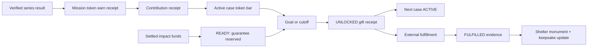

# Play for Good: детальная gap-карта текущего продукта

Статус: research proposal, не product authority и не implementation status.

Основание: утверждённый `VISION.md` v3.0 из root-коммита `cbe08ac` и
`vision-patch-play-for-good-proposal.md`. Срез кода, документации и публично
доступного приложения исследован 30.07.2026. Изменчивый rollout/readiness
по-прежнему подтверждается только
`swipe-backend/docs/specs/IMPLEMENTATION-STATUS.md` и CI соответствующих
репозиториев.

Этот документ отвечает на четыре вопроса:

1. Что в продукте можно оставить без изменений?
2. Что нужно расширить или переякорить?
3. Что должно уйти из пользовательского пути?
4. Что отсутствует и должно быть построено как новый домен?

## 1. Резюме

Пивот не является ретемингом Island. Ядро платформы пазлов сохраняется, но
мета-слой и экономика меняются архитектурно.

| Контур | Решение |
| --- | --- |
| Лента, playable runtime, каталог, verified series result | **Сохранить** |
| Звёзды и личный уровень | **Сохранить**, явно отделить от VIP и денег |
| Старые `puzzles` | **Ретемить только в UX**, но не конвертировать исторический баланс; заморозить legacy-ledger |
| Миссионные «лапки» | **Построить новый contribution ledger**; начисление автоматически направляется в ACTIVE-кейс |
| Кейс/сезон, lifecycle, impact pool, gift receipt | **Построить новый `mission_*` / `impact_*` домен** |
| Коллекции | **Перепостроить server-owned**; нынешняя реализация — локальная демонстрация |
| Island | **Не переименовывать**; взять отдельные инженерные паттерны, затем вывести из основного пути |
| Приют/история добра | **Построить как новую проекцию** над mission-данными |
| Challenge/share | **Сохранить как вторичный рельс**, расширить campaign/help ссылками |
| Боты | **Запретить в mission namespace**; legacy Island-ботов выключить при снятии Island |
| Holdout | **Построить отдельный mission experiment**, не записывать как расширение C1 |
| Подписка | **Не реализовывать до monetization/legal gate**, но заложить схемные расширения |
| Фабрика механик, `swipe-ugc`, `playables` | **Не переделывать в первом срезе** |
| Platform scheme/scoreboard/docs | **Обновить**, потому что они всё ещё описывают VISION v2 |

Критический путь выглядит так:

## 2. Что исследовано

### Product authority и связанные документы

- `VISION.md` v3.0 и протокол решений.
- root `CLAUDE.md`, `AGENTS.md`, `AGENT-ROLES.md`.
- `platform-scheme/README.md`, `template.html`, `hypotheses.json` и
  построенные `dist`-артефакты.

### Пользовательский продукт

- `feed-prototype/src/feed.ts`, `api.ts`, `outbox.ts`, `telemetry.ts`,
  `collections.ts`, `island.ts`, `island-state.ts`, `main.ts`,
  `telegram.ts`, reward helpers и browser-checks.
- `feed-prototype/README.md` и `ISLAND.md`.
- Публичная версия `https://swipe-platform.onrender.com/`: видимые вкладки,
  HUD и основной post-series путь.

### Backend и данные

- Session/result/daily/event/challenge endpoints.
- Все Island endpoints и модели.
- Reward, puzzle, verified-run и social ledgers.
- Control-plane, append-only receipts, operator auth, outbox и moderation
  patterns.
- C1 content analytics и cohort observability contracts.
- Settings, router mounting, rollout flags и migrations.

### Остальной workspace

- `swipe-generator` и Lab.
- `swipe-ugc`.
- `playables`.
- `swipe-agents`, включая Finance v1-A.
- Legacy P4G workspace только для определения границы; он не входит в план
  миграции.

## 3. Фактическое состояние продукта

### 3.1 Публичная пользовательская поверхность

В исследованном публичном клиенте присутствуют четыре вкладки:

- Daily;
- Meta;
- Feed;
- Collections.

HUD показывает личный уровень и баланс `puzzles`. Meta ведёт в Island.
Постоянной поверхности активного кейса, token goal, четырёх денежных фактов,
UNLOCKED/FULFILLED-церемоний и истории помощи нет.

Это означает: миссия пока не является причиной открыть приложение и не
считывается в первой сессии. Добавление экрана внутри старой Meta-вкладки не
исправит этот разрыв — текущий кейс должен быть виден из основного игрового
пути.

### 3.2 Источники личного прогресса

Сейчас существуют две server-owned величины:

- `RewardLedger.stars`: личный игровой прогресс;
- `PuzzleLedger.puzzles`: старая мета-валюта.

`VerifiedRun` и ticket-bound `/results` дают надёжное подтверждение завершения
уровня/серии. Это правильная точка выдачи новых миссионных токенов и
server-derived карточек коллекции.

Но `puzzles` уже начисляются не только за qualified series:

- starter grant;
- сундук серии;
- daily quests;
- Island gifts/collect;
- социальные Island-события.

Island-боты могут создавать активность, из которой у живого владельца
появляется старая Island-награда. Кроме того, `award_puzzles()` игнорирует
неположительные значения: существующий ledger реализует выдачу, но не
полноценный атомарный spend.

Вывод: перенос старого баланса в публичный миссионный вклад нарушит
human-true-инвариант и создаст неаудируемую стартовую эмиссию.

### 3.3 Коллекции

Нынешние коллекции не являются продуктовой системой:

- одна коллекция захардкожена в клиенте;
- прогресс хранится в `localStorage`;
- есть demo-prepopulation;
- drop использует `Math.random`;
- карточки после сундука имеют presentation-only семантику;
- backend inventory, drop receipt, duplicate handling, archive и completion
  отсутствуют.

Визуальные компоненты можно сохранить, но данные и экономика должны быть
заменены полностью.

### 3.4 Island

Island — большой самостоятельный домен:

- UGC generation/bake/theme jobs;
- карта и здания;
- рост от чужих plays;
- визиты, лайки, подарки;
- friend codes/friendships;
- notification outbox;
- reports/takedowns/moderation;
- bots и bot plans;
- client CAS cache;
- закрытая доставка артефактов.

Это не модель приюта. Если переиспользовать `island_state` как authority для
миссии, возникнет смешение:

- client-authored snapshot и server-owned charitable facts;
- публичных human-true вкладов и bot/guest activity;
- UGC moderation authority и impact/finance authority;
- декоративного здания и доказанного реального fulfillment.

Переиспользовать нужно паттерны и некоторые UI-примитивы, а не таблицы и
семантику домена.

### 3.5 Деньги и fulfillment

В продукте нет:

- учёта eligible net revenue;
- settlement windows;
- impact pool;
- резервирования гарантии;
- расчёта `unlock_share`;
- gift receipt;
- payout/transfer receipt;
- fulfillment evidence;
- rollover.

`swipe-agents` Finance v1-A наблюдает расходы инфраструктуры. Это read-only
cost observability, а не источник благотворительных денег. Его decimal и
immutable snapshot patterns полезны, но данные нельзя смешивать.

### 3.6 Аналитика

Существующий C1 отвечает на вопросы о ленте и прохождении контента.
`cohort-observability.md` буквально исключает organic return, retention,
межсессионный time-to-qualified и причинные гипотезы.

`/api/events` и клиентская telemetry — best-effort: события могут быть
потеряны. Они пригодны для UI-диагностики, но не для:

- impact accounting;
- experiment assignment;
- authoritative exposure;
- contribution receipt;
- retention denominator, если нужен воспроизводимый причинный отчёт.

### 3.7 Документация продукта

`platform-scheme/README.md` всё ещё называет схему визуализацией VISION v2.
`template.html`, `hypotheses.json` и собранный HTML описывают генеративную
мету, токены кастомизации, Island VIP и social-only collections. Это
противоречит v3.0.

## 4. Инвариант → существующая точка → необходимое изменение

| Инвариант VISION v3.0 | Что уже есть | Gap / действие |
| --- | --- | --- |
| Любимые пазлы теперь помогают | Игровая лента и серии | Добавить case surface и mission reward в основной loop |
| Один сезон = один кейс | Нет модели сезона/кейса | Новый immutable case contract |
| Только READY может стать ACTIVE | Нет pool/reservation | Финансовый ledger + reserve receipt + DB transition guard |
| Один ACTIVE-кейс | Нет | Unique/serialized server invariant |
| Goal или cutoff → UNLOCKED | Нет | Append-only lifecycle и идемпотентный unlock writer |
| Следующий сезон начинается сразу после UNLOCKED | Нет | Транзакционный/сериализованный handoff активного кейса |
| Реальная передача позже → FULFILLED | Нет | Отдельный transfer/evidence workflow; не блокировать следующий сезон |
| Токены не выдаются за деньги | Старый HUD только balance | Развести token progress и четыре денежных факта |
| Вклад — автоматический, но ощущается дискретным актом | Result receipt есть | Атомарный earn+contribution receipt и отдельная церемония |
| Недостижение цели не failure | Нет mission UI | Cutoff ceremony с фактическим progress и позитивной формулировкой |
| Human-true | VerifiedRun есть; Island bots есть | Mission writers принимают только human qualified evidence |
| Коллекции дают больший вклад | Только client demo | Server inventory/drop/completion ledger |
| Архив дозакрываем | Нет | Versioned collection availability и archive projection |
| Keepsake несёт реальный итог | Нет | Draft at UNLOCKED, evidence-bearing update at FULFILLED |
| VIP помогает общему делу, не покупает личную причастность | Подписки нет; `User.is_premium` = Telegram Premium | Отдельные product entitlement и base/VIP ledger components |
| Один активный кейс всегда на поверхности | Meta/Island скрывает старую мету | Постоянный case header/card в Feed и post-series ceremony |
| Fulfilled case остаётся памятником | Island buildings есть, но другая truth | Новая shelter/history projection |
| Campaign traffic видит mission и исключён из holdout | Challenge start param есть | Новые signed campaign/help intents и attribution receipt |
| Holdout проверяет эффект миссии | Feed assignments/C1 patterns есть | Отдельный mission experiment и retention report |
| Никакой charity-lootbox | Сундук с наградой есть | Подарок не рандомизировать; формула и receipt детерминированы |
| Никаких guilt/panic mechanics | Нет mission copy | Copy contract, notification policy и UX review |

## 5. Новые backend-домены

Названия ниже — рекомендуемая декомпозиция, а не утверждённая схема миграций.

### 5.1 Case contract и lifecycle

Нужны:

- `mission_case_versions` — immutable bytes/digest:
  - animal/case identity;
  - partner/recipient;
  - need and deliverables;
  - guaranteed help;
  - stretch uses;
  - token goal;
  - deterministic `unlock_share` config;
  - unlock cutoff;
  - latest fulfillment date без panic countdown;
  - eligible settlement window;
  - currency;
  - media/evidence policy;
  - rollover rule;
- `mission_cases` — stable identity и pinned published version;
- `mission_case_events` — append-only
  `DRAFT/READY/ACTIVE/UNLOCKED/FULFILLED`;
- `mission_case_activation_receipts`;
- `mission_case_unlock_receipts`;
- `mission_case_fulfillment_receipts`.

Минимальные DB-инварианты:

- не более одного ACTIVE;
- ACTIVE ссылается только на READY/reserved case version;
- UNLOCKED имеет terminal immutable gift receipt;
- FULFILLED имеет transfer receipt и evidence digest;
- sequence case progress монотонен;
- replay возвращает тот же receipt;
- late accounting correction не уменьшает уже открытый подарок.

### 5.2 Миссионные токены

«Puzzles → лапки» принимается как продуктовый ретеминг: игрок видит одну
понятную валюту участия вместо старой Island-валюты. Но исторические
`PuzzleLedger` rows и баланс не становятся вкладом.

При автоматическом вкладе отдельный spendable wallet не нужен. Создать
отдельно от `PuzzleLedger`:

- `mission_contributions`:
  - `user_id`;
  - source identity;
  - case id/version, ACTIVE в момент server acceptance;
  - base amount;
  - VIP amount отдельной колонкой/компонентом;
  - contribution sequence;
  - idempotency key;
  - immutable response receipt.

Источники v1:

- verified series completion;
- server-owned daily quest completion/claim;
- server-owned collection completion.

Не включать автоматически:

- starter grant;
- старый puzzle balance;
- исторические `puzzles`, ранее начисленные за daily quests;
- Island collect/gifts;
- client event;
- bot activity;
- client-asserted Island completion.

Daily writer должен начислять новые mission tokens напрямую в
`mission_contributions`, а не сначала выдавать `puzzles` и затем конвертировать
их.

Личный уровень/keepsake participation считается только от base qualified
activity. VIP виден отдельной строкой и двигает общий bar, но не личный статус.

### 5.3 Граница сезона во время игры

Глобальный кейс может смениться, пока игрок проходит серию. При принятом
автоматическом режиме backend в одной транзакции:

1. Валидирует source evidence — verified series, daily claim или collection
   completion.
2. Блокирует/читает реально ACTIVE-кейс.
3. Создаёт contribution receipt прямо в этот кейс.
4. Возвращает case id, base/VIP split, contribution seq и новый progress.

Если игрок начал серию при кейсе A, а закончил после активации B, его лапки
идут в B. Это не скрытый перенос: exact receipt и церемония показывают B.
Вклад в UNLOCKED-кейс невозможен по транзакционному инварианту.

Личного неиспользованного остатка и token carry-over нет. Автоматизм не
убирает агентность переживания: игрок заработал конкретный вклад, видит его
отдельной церемонией и видит подтверждённый сдвиг общего bar.

### 5.4 Impact pool

Нужен отдельный exact-money subledger в minor units:

- seed;
- eligible revenue settlement;
- partner contribution;
- future subscription share;
- reserve;
- release/rollover;
- payout/transfer;
- correction.

Рекомендуются либо double-entry accounts, либо равносильные CHECK/transaction
invariants для:

- available;
- reserved;
- unlocked;
- paid;
- rolled over.

READY резервирует гарантию. UNLOCKED резервирует весь вычисленный подарок.
FULFILLED фиксирует реальную передачу и evidence.

Для первого пилота не нужна прямая интеграция с банком или ad provider:
достаточен attended, dry-run-first импорт immutable settlement receipt и
ручное подтверждение внешней передачи.

### 5.5 Settlement lag и rolling impact pool

Ad provider может показать предварительную выручку сегодня, но финально
подтвердить net revenue после закрытия периода, комиссий и корректировок.
Поэтому token goal может быть достигнут раньше, чем деньги, заработанные в
том же сезоне, станут settled.

Для продукта не обязательно привязывать кейс к одному заранее названному
календарному revenue window. Проще использовать rolling impact pool:

1. Доля выручки входит в impact pool только после settlement.
2. Каждый ACTIVE-кейс уже имеет отдельно зарезервированную гарантию.
3. В момент goal/cutoff backend делает snapshot ещё не распределённых
   settled-средств.
4. `unlock_share(token progress)` открывает соответствующую часть этого
   доступного остатка, но не больше подтверждённой потребности + stretch.
5. Неиспользованный остаток и revenue, settled позднее, остаются для
   следующих кейсов.

Пример: гарантия кейса — €100. В pool к моменту заполнения bar есть €240
settled и не распределено; подтверждённые need + stretch позволяют принять
ещё €200. При 100% token progress подарок становится €300: €100 гарантии +
€200 дополнительной помощи. Оставшиеся €40 и новые settlement receipts идут
в следующие сезоны.

Так не нужен денежный progress goal и нет глобального cap. Публикуются
гарантия, token goal и формула. Точная дополнительная сумма появляется в
UNLOCKED receipt. Предварительную рекламную выручку игроку не обещают и
задним числом подарок не уменьшают.

### 5.6 Evidence и публичное доверие

Нужны:

- transfer reference и сумма;
- дата;
- recipient/partner;
- структурированный mini-report;
- photo/video/document artifacts;
- digest exact bytes/revision;
- права на публикацию и срок хранения;
- безопасная public projection;
- takedown/replacement не переписывает исторический факт, а добавляет новую
  revision/revocation.

R2 closed-delivery и moderation дают полезные паттерны, но charitable evidence
требует отдельной authority и privacy policy.

## 6. Backend: конкретные точки изменения

### Расширить

- `app/api_results.py`
  - в той же транзакционной области создавать mission earn receipt и
    collection drop receipt;
  - вернуть их в exact replay response;
  - не писать contribution из best-effort post-commit hook;
- `app/api_session.py`
  - active case projection;
  - participant mission balance;
  - contribution mode/enrollment;
  - collection projection;
  - pending UNLOCKED/FULFILLED ceremony watermarks;
  - experiment assignment/exposure data;
- `app/main.py`
  - mission public/operator routers;
- `app/config.py`
  - default-off `ENABLE_MISSION_*`;
  - dependency validators;
- migrations
  - новые mission/impact/collection/experiment tables;
- challenge/social layer
  - canonical human graph или нейтральная social service;
  - signed campaign/help intents.

### Переиспользовать как паттерн

- `VerifiedRun` и run ticket binding;
- reward idempotency и exact result replay;
- Island claims/outcomes + row locking + seq;
- notification outbox/attempts;
- moderation exact-revision/takedown;
- catalog config digest/pinned version;
- feed assignment receipt;
- operator grant/scope/CAS/dry-run patterns;
- R2 private artifact delivery.

### Не переиспользовать как mission authority

- `PuzzleLedger`;
- `island_states`;
- `island_meta_events`;
- Island completion claims;
- `/api/events`;
- `User.is_premium`;
- content mobile-review action enum/table как общий impact workflow.

Последний пункт важен: transport/auth pattern можно взять, но content
publication и charitable/financial authority должны оставаться разными
scope и журналами, даже если оператор пока один человек.

## 7. Frontend: новая информационная архитектура

### 7.1 Feed shell

В `src/feed.ts`:

- добавить всегда видимую компактную поверхность активного кейса;
- убрать `puzzles` из главного HUD после выключения legacy Island;
- оставить stars/личный level;
- показать mission-token balance только там, где он объясняет следующий акт;
- изменить нижнюю навигацию:
  - Feed остаётся;
  - Collections остаётся после server-owned переделки;
  - Meta/Island заменяется Shelter/Impact;
  - Daily остаётся;
- не прятать case progress только внутри Shelter.

### 7.2 Post-series loop

Сейчас сундук ведёт к Island visit-card или challenge CTA. Новый порядок:

1. exact result receipt;
2. показать base mission tokens и отдельный VIP bonus, если существует;
3. показать server-owned collection drop;
4. показать server-confirmed automatic contribution;
5. видимый сдвиг общего bar и personal receipt;
6. если произошёл UNLOCKED — точная общая церемония;
7. вторичные CTA: campaign share и challenge.

Island visit-card из этого arbitration stack убрать.

Никакого optimistic движения публичного token bar. Пока нет server receipt,
можно анимировать ожидание, но не подтверждённый вклад.

### 7.3 Case detail

Экран должен раздельно показывать:

- вклад сообщества в токенах;
- что гарантировано;
- что зарезервировано и открыто;
- что реально передано.

Рядом:

- имя/история животного;
- конкретный need;
- stretch uses;
- cutoff без угрозы failure;
- latest fulfillment date;
- объяснение формулы в один tap;
- partner;
- verified history/reports.

### 7.4 Две церемонии

UNLOCKED:

- «Платформа гарантировала и зарезервировала …»;
- «Сообщество открыло ещё X»;
- следующий кейс уже становится активным;
- слово «передали» запрещено.

FULFILLED:

- подтверждённая передача/действие;
- фото/видео;
- mini-report;
- обновление памятника и keepsake;
- отдельная естественная share-точка.

### 7.5 Shelter / история

Новая поверхность:

- активный кейс;
- памятники FULFILLED-кейсов;
- UNLOCKED-кейс в ожидании реального отчёта с честным статусом;
- личные коллекции;
- сезонные keepsakes;
- личная история base participation.

Можно сохранить визуальные примитивы карты, конфетти и watermark из Island,
но source of truth — новая mission projection.

### 7.6 Удалить из основного пути

- Creator District / `?metaworld=1`;
- создание, remix и upgrade механик как центр меты;
- здания, растущие от чужих plays;
- случайный Island guest gift;
- bot activity;
- Island friend row как вход в миссионный слой;
- старую локальную коллекцию после включения server-owned версии.

Удаление данных на этом этапе не требуется.

### 7.7 Ошибки и offline

- cached case можно показывать с freshness marker;
- деньги и contribution progress нельзя увеличивать offline;
- повтор запроса обязан вернуть exact receipt;
- result, принятый после смены сезона, показывает case id из receipt;
- недоступное evidence имеет текстовый fallback;
- фото/видео не должны быть единственным носителем результата.

## 8. Collections v1

### Backend

- immutable collection/card definitions, pinned к season/case;
- card inventory/drop ledger;
- deterministic drop policy version;
- duplicate conversion/universal fragments;
- completion receipt;
- larger base mission-token award;
- archive availability;
- keepsake issuance/update;
- collection assist intents/receipts.

### Client

- удалить demo prefill и `Math.random`;
- получить inventory из session/API;
- показать exact drop receipt;
- archive tab;
- прогресс и duplicates;
- completion ceremony;
- help CTA;
- keepsake с реальным итогом.

### Авторство v1

Первую коллекцию лучше собрать руками как versioned content pack. Подключение
setting factory до проверки mission loop добавит не нужную пилоту зависимость.
Генератор можно подключить позже, когда станет понятно, какие коллекционные
темы и ассеты действительно работают.

## 9. Social и виральность

### 9.1 Campaign share

Нужен signed server-issued intent:

- campaign/case identity;
- sender, если допустимо политикой privacy;
- expiry и replay semantics;
- landing attribution;
- forced mission exposure;
- исключение из causal holdout;
- identity-JOIN до первого relevant surface.

Получатель должен сразу видеть тот же case/message, а затем входить в autoplay
механику.

### 9.2 «Попросить помочь» коллекции

Предлагаемый positive-sum loop:

1. Владелец выбирает недостающую карточку и создаёт help link.
2. Друг открывает exact intent.
3. Друг проходит короткую qualified series.
4. Backend связывает verified run с help intent.
5. Владелец получает fragment/card help receipt.
6. Помощник получает обычные base mission tokens за свою игру.
7. Никто не теряет карточку; коллекция остаётся solo-completable.

Guardrails:

- self-help запрещён;
- один run не закрывает несколько несовместимых intents;
- per-pair/per-day caps;
- idempotency;
- bot/test principals исключены;
- помощь не выдаётся за click/install;
- helper series остаётся настоящим qualified play.

Challenge можно сохранить как отдельную вторичную механику. Не стоит заставлять
игрока соревноваться, чтобы помочь.

## 10. Holdout и доказательство эффекта миссии

### 10.1 Что именно проверяется

Holdout отвечает не на вопрос «нравится ли экран», а на причинный вопрос:

> Возвращаются ли и играют ли больше люди, которым показали Play for Good,
> по сравнению с эквивалентными людьми, которым миссионный слой пока не
> показали?

Основной анализ — intent-to-treat: сравниваются назначенные группы, а не
contributors против non-contributors. Иначе self-selection почти гарантирует
ложный положительный эффект.

### 10.2 Нужная инфраструктура

- versioned persistent assignment;
- control/base и mission exposure;
- delayed release для control;
- authoritative first exposure receipt;
- campaign exclusion;
- новый server-owned session/open fact или эквивалентная воспроизводимая
  мера активного дня;
- qualified retention из `VerifiedRun`;
- immutable experiment config/report;
- sample-size/power gate до чтения результата.

### 10.3 Метрики

Outcome:

- D1/D7 qualified retention;
- active days;
- qualified plays per assigned user.

Leading:

- first mission surface viewed;
- time to first earned token;
- time to first contribution;
- доля увидевших собственный сдвиг bar;
- UNLOCKED и FULFILLED ceremony view;
- evidence view;
- fulfilled-case share;
- help link acceptance и helper qualified series.

Trust/comprehension:

- понимает ли игрок, что платформа платит, а он направляет;
- различает ли «зарезервировано» и «передано»;
- воспринимает ли механику как честную;
- нет ли guilt/fatigue.

Guardrails:

- gameplay completion;
- first-session latency;
- notification opt-out;
- complaint/report rate;
- finance reconciliation;
- evidence SLA.

### 10.4 Каденция

- Founder/friend dogfood: все видят mission, qualitative comprehension.
- Маленькая закрытая когорта: instrument and debug, не causal verdict.
- Holdout включается только после расчёта выборки; для умеренного эффекта это
  вероятнее сотни, а не 30–50 пользователей.

C1 можно использовать как источник gameplay denominators, но mission causal
report должен быть отдельным продуктом аналитики.

## 11. Impact/operator console

Нужен отдельный контур полномочий:

- `impact:case:draft`;
- `impact:partner:verify`;
- `impact:finance:settle`;
- `impact:finance:reserve`;
- `impact:case:activate`;
- `impact:case:unlock`;
- `impact:evidence:publish`;
- `impact:case:fulfill`.

Рабочий процесс:

1. Завести partner/recipient и подтвердить реквизиты.
2. Создать immutable case version.
3. Импортировать seed/settled funds.
4. Зарезервировать guarantee.
5. Сделать READY.
6. Активировать.
7. Дождаться goal/cutoff.
8. Создать UNLOCKED receipt и активировать следующий кейс.
9. Передать помощь вне платформы.
10. Загрузить transfer/evidence.
11. Сделать FULFILLED.

Обязательные reconciliation views:

- available/reserved/unlocked/paid/rollover;
- stuck ACTIVE после cutoff;
- stuck UNLOCKED после latest fulfillment date;
- unmatched transfer;
- evidence без rights/alt text;
- отрицательный/несогласованный баланс;
- публичная projection против ledger.

`swipe-agents` позже может читать эти данные и напоминать. Он не должен
активировать кейс, резервировать деньги, переводить средства или публиковать
evidence.

## 12. Daily — решение принято

Daily quests остаются и начисляют лапки. Реализация:

- server-owned quest completion/claim становится допустимым source нового
  `mission_token_ledger`;
- reward receipt идемпотентен и содержит quest/day identity;
- старые daily `puzzles` не конвертируются в лапки;
- после включения миссионной экономики daily reward writer перестаёт выдавать
  старую Island-валюту и выдаёт mission tokens;
- quest progress остаётся привязан к реальной активности, которую уже
  подтверждает backend.

Величина награды за login-only quest и игровые quests остаётся versioned
настройкой экономики. Это позволяет сделать вход мягким, но основную эмиссию
оставить за реальной игрой.

## 13. План controlled retirement Island

Решение оператора: убрать legacy Island из продукта сейчас, не ждать готового
Shelter. Данные не удаляются.

### 13.1 Немедленно убрать пользовательскую поверхность

1. Выпустить клиент с выключенными `VITE_ISLAND_ENABLED`,
   `VITE_ISLAND_VISIT_AWARDS_ENABLED` и
   `VITE_ISLAND_NOTIFICATIONS_ENABLED`.
2. Проверить release manifest: Meta, friends row, Island polling/deep links и
   post-chest visit card отсутствуют.
3. На backend выключить `ENABLE_ISLAND_BOTS`,
   `ENABLE_ISLAND_VISIT_AWARDS`, `ENABLE_ISLAND_NOTIFICATIONS` и
   `ENABLE_ISLAND_SOCIAL`.
4. Выключить `ISLAND_REWARDS_ENABLED`, чтобы старый/cached client не создавал
   новую Island-эмиссию.

### 13.2 Закрыть остаточные server routes

Перечисленных флагов недостаточно для полного выключения. В `app/main.py`
безусловно монтируются:

- `island_state_router`;
- `island_social_router` с public/visit/like и artifact URL;
- `island_router` с theme/bake jobs.

Нужен верхнеуровневый default-off gate или явные route guards, которые
останавливают:

- state read/write;
- новые public visits/likes;
- theme generation;
- bake generation.

Иначе старый cached client или прямой вызов продолжит пользоваться Island и
может создавать model/storage cost даже после выключения новой social core.

### 13.3 Что оставить

- `ENABLE_ISLAND_CLOSED_DELIVERY` оставить включённым на bounded deprecation
  period: это защитный read-path уже опубликованных private artifacts, а не
  engagement feature. Его выключение не является необходимым условием снятия
  Island и может ухудшить безопасность/fallback semantics для старых клиентов.
- moderation/recall и exact artifact identity сохранить;
- legacy tables и артефакты оставить read-only;
- после quiet period отдельно решить retention/delete/export;
- `?metaworld=1` удалить при безопасной чистке frontend meta-кода; он не
  блокирует выключение.

Это обратимый rollout без destructive migration.

## 14. Repo-by-repo карта

### root

Изменить:

- `platform-scheme/README.md`;
- `platform-scheme/template.html`;
- `platform-scheme/hypotheses.json`;
- пересобрать и переопубликовать визуализацию;
- после появления реальных схем — durable decisions в `CLAUDE.md`;
- `AGENTS.md`, если появится новый отдельный repo/service.

Не использовать legacy P4G workspace как базу новой реализации.

### `swipe-backend`

Главная работа:

- mission/impact/collection/experiment models;
- migrations;
- public and operator APIs;
- results/session integration;
- lifecycle and money services;
- help/campaign intents;
- reconciliation and reports;
- flags and tests.

### `feed-prototype`

Главная работа:

- case shell;
- reward/contribution ceremony;
- exact result types/outbox;
- server-owned collections;
- shelter/history;
- new start params;
- campaign/help share;
- Island UI retirement;
- browser acceptance coverage.

Большой `feed.ts` стоит распилить по mission surfaces до расширения:

- `mission-case.ts`;
- `mission-contribution.ts`;
- `mission-ceremonies.ts`;
- `mission-collections.ts`;
- `shelter.ts`.

Это не отдельный архитектурный проект: распил нужен там, где всё равно
вносятся изменения.

### `swipe-generator`

В первом slice:

- core factory не трогать;
- при необходимости добавить отдельную ссылку в Lab на Impact Console, но не
  смешивать content publication actions и impact actions.

Позже:

- season-themed settings/card assets;
- operator briefs из case theme;
- human review всех публичных материалов.

### `swipe-ugc`

- не использовать как mission state;
- сохранить для content pipeline и legacy artifact delivery;
- заморозить расширение Island-specific generation;
- decommission только после решения по архиву старого UGC.

### `playables`

- не менять механику ради благотворительности;
- playable сообщает игровой outcome как раньше;
- host/backend начисляет mission rewards;
- campaign identity может потребовать только расширения deep-link manifest,
  не charitable logic внутри playable.

### `swipe-agents`

- Finance v1-A оставить cost-observability;
- позже добавить read-only impact watchers;
- никаких mutating finance/case authorities.

### Deployment repo

- публиковать собранный feed artifact обычным release-путём;
- не править generated index/assets вручную;
- mission и Island флаги переключать независимо.

## 15. Последовательность реализации

### P0-A. Выключить legacy Island

- клиентские Island-флаги off и новый release;
- social/bots/visit-awards/notifications/rewards off;
- верхнеуровневый gate остаточных state/public/theme/bake routes;
- closed delivery + moderation оставить как защитный read-path;
- данные не удалять.

### P0-B. Закрыть mission contracts

До кода:

- rolling settled-pool allocation rule;
- currency/minor units/FX;
- evidence rights/consent;
- Island shutdown criteria.

Результат: backend contract + data model + API schema + threat/abuse review.

### P1. Founder dogfood vertical slice

- один seeded local-shelter case;
- impact seed/reserve;
- READY/ACTIVE;
- mission earn из verified series;
- contribution receipt;
- token goal/cutoff;
- UNLOCKED receipt;
- immediate next-case activation;
- ручной external fulfillment;
- evidence + FULFILLED;
- минимальный current-case UI и обе церемонии;
- всё default-off.

Коллекции, карта приюта и публичный holdout не блокируют P1.

### P2. Операционная честность

- separate Impact Console/CLI;
- settlement import;
- reconciliation;
- partner/evidence workflow;
- incident/runbook;
- public four-fact projection;
- two consecutive real cases.

### P3. Server-owned collections

- definitions/inventory/drop/completion/archive;
- larger mission reward;
- keepsake draft/final update;
- replace local demo.

### P4. Shelter

- history/monuments/personal showcase;
- добавить новую Shelter-поверхность вместо уже снятого Island;
- памятники, keepsakes и статус ожидающего fulfillment;
- legacy Island данные остаются вне нового namespace.

### P5. Виральность

- campaign share;
- fulfilled-case share;
- collection help;
- attribution and anti-abuse;
- challenge остаётся вторичным.

### P6. Mission experiment

- assignment/exposure/delayed holdout;
- retention/session facts;
- causal report;
- sample-size gate;
- campaign exclusion.

### P7. Monetization

Только после отдельного решения:

- ads settlement integration;
- product subscription entitlement;
- unconditional SKU share;
- VIP base/bonus token split;
- legal and copy review.

## 16. Acceptance gates по срезам

### Accounting

- сумма source-bound contribution receipts равна progress projection;
- один source receipt не создаёт два вклада;
- bot/test principals не входят в public progress;
- exact replay byte/stable semantic equivalent;
- late result на границе сезона не попадает в закрытый case.

### Money

- ACTIVE невозможен без reserved guarantee;
- UNLOCKED gift покрыт reservation;
- `gift` воспроизводится из pinned inputs;
- correction не уменьшает published gift;
- public four facts сходятся с subledger;
- FULFILLED невозможен без transfer/evidence.

### Product

- первый вклад достижим в первой сессии;
- current case виден без входа в Shelter;
- goal не достигнут → нет failure copy;
- UNLOCKED не говорит «передали»;
- FULFILLED даёт второй эмоциональный момент;
- solo collection completable;
- VIP не увеличивает personal mission level.

### Rollout

- все mission writers default-off;
- mission-off сохраняет базовую игру;
- campaign link не попадает в control;
- Island и mission флаги независимы;
- rollback не требует удаления mission ledgers.

### Safety/trust

- partner verified;
- media consent/right recorded;
- alt/text fallback;
- takedown/revocation;
- нет tragedy-porn/panic push;
- нет случайной денежной награды;
- formula disclosure доступно из case screen.

## 17. Реальные оставшиеся решения

Решение об автоматическом вкладе закрывает прежнюю pilot-развилку. Перед
implementation spec его нужно коротко внести в `VISION.md`: утверждённый
v3.0 пока ещё называет ручное подтверждение против автоматического внесения
versioned pilot-гипотезой.

### Требуют фиксации в implementation contract

1. **Как распределяется settled revenue при UNLOCKED?**

   Рекомендация: rolling impact pool. В подарок входят только уже settled,
   ещё не распределённые средства; revenue, подтверждённая позже, помогает
   следующим кейсам.

2. **Какая минимальная evidence/consent policy у локального shelter?**

   Нужна до публикации первого реального животного.

### Не блокируют первый slice

- название и иконка токенов;
- точная величина награды;
- drop rates коллекций;
- гео-сезоны;
- subscription tiers;
- автоматическое revenue ingestion;
- генерация сезонного арта фабрикой.

## 18. Поправки к существующему `play-for-good-gap-map-v1.md`

В workspace найден отдельный untracked draft. Он полезен как инвентаризация,
но перед использованием в качестве плана в нём нужно исправить:

1. `puzzles → лапки` не является безопасной рекомендацией: баланс загрязнён
   starter/daily/Island/bot-derived источниками. Продуктово лапки заменяют
   puzzles, но исторический ledger не конвертируется; auto-вклад пишется новым
   contribution receipt.
2. Mission retention/holdout нельзя просто добавить в C1: contract C1
   исключает retention и causal hypotheses.
3. Best-effort cp/client events нельзя делать authority для exposure и
   contribution.
4. Content mobile-review action kinds нельзя превращать в impact/finance
   authority; переиспользуется pattern, а не общий журнал полномочий.
5. `island_state` не должен становиться состоянием приюта; нужен новый mission
   domain и projection.
6. Перечисленных Island-флагов недостаточно для полного выключения:
   state/social/theme/bake routers частично монтируются без
   `ENABLE_ISLAND_SOCIAL`, а `ISLAND_REWARDS_ENABLED` остаётся default-true;
   нужен верхнеуровневый gate и отдельное выключение rewards. Closed delivery
   при этом лучше оставить защитным read-path.
7. Первую коллекцию не стоит ставить в зависимость от setting factory.
8. Когорты 30–50 недостаточно объявлять causal holdout без power calculation.
9. Документ внутренне не нормализован: TL;DR и основные разделы всё ещё
   называют валюту/Island открытыми вопросами, а нижний decision log уже
   объявляет их решёнными.
10. Принятый auto-вклад нужно провести через всю карту и коротко обновить
    `VISION.md`, где manual-vs-auto пока остаётся pilot-развилкой.

## 19. Итог

Проект не требует переписывать игровую платформу. Самые ценные готовые части —
verified play, exact result receipts, каталог, лента, share primitives,
append-only инженерные паттерны и operator gates.

Но слой Play for Good должен быть новым серверным доменом. Три вещи нельзя
делать сокращённым путём:

- конвертировать исторический `puzzles`-баланс в публичный вклад;
- считать Island состоянием приюта;
- использовать telemetry/C1 как доказательство денег или причинного эффекта.

Первый законченный результат — не «новый остров» и не коллекции. Это один
маленький реальный кейс, который проходит полный честный цикл:

`READY → ACTIVE → заработанный вклад → UNLOCKED → следующий ACTIVE →
реальная передача → FULFILLED → доказательство`.
